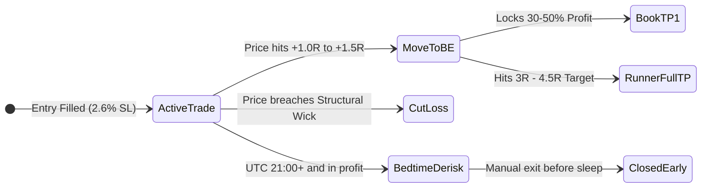

# Empirical Behavioral Analysis & Cognitive Profile: @learnernoearner

**Subject**: Signal Provider `@learnernoearner` (Telegram Channel ID: `-1001252615519`, Twitter/X updates, YouTube market updates)  
**Corpus Analyzed**: 784 Telegram messages, 97 canonical trade setups, 230 TradingView chart screenshots  
**Dataset Date Range**: 2026-08-25 to 2026-11-09  
**Source of Truth**: PostgreSQL production database (`fatty_trader`) and local media archive

---

## 1. Executive Summary & Psychological Archetype

The trader is an **asymmetric, range-based swing/momentum trader** operating on high-beta altcoins. He does not use standard lagging indicators (no RSI, MACD, or Bollinger Bands). Instead, he navigates markets using a **discretionary 3-tier horizontal range model** anchored by Bitcoin/Ethereum macro context, structural wick invalidations, and active intraday trade management.

```
┌─────────────────────────────────────────────────────────────────────────────────┐
│                          CORE TRADER PROFILE ATTRIBUTES                         │
├───────────────────────────────┬─────────────────────────────────────────────────┤
│ Directional Bias              │ 80.4% LONG (78) · 19.6% SHORT (19)              │
│ Primary Tradable Assets       │ WLD, PUMP, ENA, ZEC, PENGU, INJ, MAGIC, NEAR    │
│ Macro Anchor Assets (No Trade)│ BTC, ETH (Used purely as market regime compass) │
│ Median Stop-Loss Distance     │ 2.60% (Mean: 2.67%, Range: 0.13% - 7.21%)       │
│ Planned Risk-to-Reward (R:R)  │ Median: 4.56R (Mean: 4.72R)                     │
│ Target Distribution           │ 92.8% of signals have exactly 1 target level    │
│ Primary Trading Windows (UTC) │ 07:00–09:00 (London) & 13:00–17:00 (NY)         │
│ Sleep / Inactive Window (UTC) │ 21:00–04:00 (Regularly derisks before sleeping) │
│ Dominant Strategy Archetype   │ Daily Midrange Retest & Liquidity Sweep Reclaim │
└───────────────────────────────┴─────────────────────────────────────────────────┘
```

---

## 2. Quantitative Empirical Evidence

### 2.1 Directional Asymmetry
Querying the 97 canonical signals recorded in `canonical_signals`:
- **LONG**: 78 setups (**80.4%**)
- **SHORT**: 19 setups (**19.6%**)

**Behavioral Insight**:  
The trader has a pronounced structural **bullish bias**. He views the crypto market primarily as an asset class to buy on dips. Shorting is treated as an exceptional measure, reserved strictly for:
1. Rejection at verified higher-timeframe Range Highs (e.g. `ETH` @ 2,700).
2. Liquidity sweeps at new daily highs with immediate wick rejection (e.g. `$PEPE short limit around 0.51 - 0.513`).
3. Severe trend breakdowns after losing multi-day support (e.g. `WLD`, `SNDK`).

### 2.2 Tradable Asset Universe vs. Macro Compass
Querying token frequencies across all 97 signals:

| Token | Setups | Direction Breakdown | Category |
| :--- | :--- | :--- | :--- |
| **WLD** | 15 | 9 LONG, 6 SHORT | High-Beta AI / Biometric |
| **PUMP** | 9 | 7 LONG, 2 SHORT | Meme / Micro-Cap Perp |
| **ENA** | 6 | 5 LONG, 1 SHORT | Synthetic Dollar / High-Beta DeFi |
| **ZEC** | 5 | 4 LONG, 1 SHORT | Legacy Privacy / Midcap Volatility |
| **PENGU**| 4 | 3 LONG, 1 SHORT | Meme Token |
| **INJ**  | 4 | 4 LONG (100% Long) | L1 Momentum |
| **MAGIC**| 4 | 3 LONG, 1 SHORT | Gaming / High Beta |
| **NEAR** | 3 | 2 SHORT, 1 LONG | High-Beta L1 |
| **GRASS**| 3 | 3 LONG (100% Long) | DePIN / Momentum |
| **PEPE** | 2 | 2 LONG (100% Long) | Blue-Chip Meme |
| **SNDK** | 2 | 1 LONG, 1 SHORT | High-Beta Speculative |
| **TRUMP**| 2 | 1 LONG, 1 SHORT | PolitiFi Meme |

**The Macro Compass Distinction**:  
- `BTC` and `ETH` appear in **dozens of analytical updates**, charts, and video reviews, but have **zero direct intraday trading signals** in the canonical ledger.
- The trader treats `BTC` and `ETH` as **high-timeframe market health indicators**. If BTC is testing major support, he seeks Longs on high-beta alts. If BTC breaks below support, all altcoin entries are frozen.

### 2.3 Stop-Loss Geometry & Risk Architecture
Analyzing $|P_{\text{entry}} - P_{\text{stop}}| / P_{\text{entry}}$ across all signals:
- **Median SL Distance**: **$2.60\%$**
- **Average SL Distance**: **$2.67\%$**
- **Standard Deviation**: $\pm 1.18\%$
- **Minimum SL Distance**: $0.13\%$
- **Maximum SL Distance**: $7.21\%$

**Behavioral Insight**:  
The stop loss is **never an arbitrary flat percentage**. It is always placed 1 to 2 ticks beyond a structural price level:
- In Longs: 1 tick below the previous swing low or daily range midpoint:
  - Message #16340: *"$NEAR placed long limits between 5.03 - 4.93 ... Sl below 4.885"* (0.9% risk buffer below range).
  - SNDK: *"$SNDK longing here at daily support ... Sl at 987. Stoploss might be too tight but will be looking for another long if hits."*
- In Shorts: 1 tick above the session wick high:
  - Message #16468: *"$PEPE short limit around 0.51 - 0.513. Stoploss placed right above todays high at 0.521"* (1.5% risk buffer).

### 2.4 Target Sizing & Planned Risk-to-Reward
Analyzing target distribution and planned R:R:
- **Target Count**:
  - Exactly 1 Target: **90 signals (92.8%)**
  - 2 Targets: 4 signals (4.1%)
  - No explicit Target (Market Scalp): 3 signals (3.1%)
- **Planned Risk-to-Reward Ratio**:
  - **Median Planned R:R**: **$4.56R$**
  - **Average Planned R:R**: **$4.72R$**

**Behavioral Insight**:  
He does not micro-manage trades with 4 or 5 tiny laddered targets. He enters with a clear, ambitious structural destination in mind—usually the opposing boundary of the multi-day range (e.g. risking 2.6% to capture ~12%).

### 2.5 Temporal Pacing & Circadian Rhythm
Signal issuance grouped by UTC hour ($N=97$):

```
Hour (UTC)  Signals  Session Alignment
─────────────────────────────────────────────────────────────
00:00-05:00   10     Asian Session (Low activity)
06:00-09:00   26     █████████████ London Open (Major Peak)
10:00-12:00   15     ███████ London Midday
13:00-17:00   25     ████████████ New York Open & Midday (Major Peak)
18:00-20:00   11     █████ NY Afternoon
21:00-23:00    5     ██ Bedtime / Derisking Window
─────────────────────────────────────────────────────────────
```

- **Day of Week**: Tuesday (**20**) and Friday (**16**) have the highest trade frequency; Sunday (**10**) has the lowest.
- **Sleep Impact**: The trader lives in UTC+0 to UTC+2 (Europe / UK / Western Asia). Around 21:00–23:00 UTC, he frequently tightens targets or manually derisks running trades to protect against overnight moves.

---

## 3. Qualitative Perspectives & Cognitive Frameworks

### 3.1 The 3-Tier Range Theory
The trader explicitly defines his core framework in his Ethereum market update:
```text
"Mainly I tried to cover this small range for people who are looking to trade it daily and I will keep it simple:
- range high 2700
- mid range 2360
- range low 2190 - 2140
Knowing where the range is and at what point in the range is important to be able to look for scalps daily"
```
His mental hierarchy:
1. **Range High**: The liquidity pool where retail breakout traders buy tops. Look for short setups or close long positions.
2. **Mid Range (50% Equilibrium)**: The confirmation pivot. If price breaks out above midrange and retests, take continuation Longs. If price rejects midrange from below, take continuation Shorts.
3. **Range Low**: The value area. Look for absorption wicks to build Long positions.

### 3.2 The Abstention Heuristic ("No-Man's Land")
The single biggest discriminator between his manual trading and naive automated bots is his willingness to **abstain**:
```text
"We are still at the same area but still no confirmation for long as we broke below 82.5k support.
Will be looking for longs once we clear 83.2k and close above it.
Currently we are retesting the previous support and this is no area to take any new position for me as I would like to wait and see how we react from this level"
```
```text
"For now no more looking at charts until we reclaim support or we reach my levels"
```
When price is floating between key levels without structural confirmation, he actively stops watching the market and issues zero signals.

---

## 4. In-Flight Trade Management & Psychological Tell-Tales



### 4.1 The 1R Breakeven Shift (`sl to entry`)
While initial targets are large ($4.5R$), his loss aversion is triggered early. As soon as price advances $\approx 1.0R$ to $1.5R$ in his favor, he issues a protection command:
- Message #16471: `"sl to entry $PEPE"`
- Message #16462: `"$LIT did 1R then hit sl... Hit tp on copytrading, placed it as i was gonna sleep"`

### 4.2 Circadian Derisking
His tolerance for unmonitored risk is low. If he has an open trade before going to sleep, he moves the take-profit target closer or closes manually:
- Verbatim: `"$LIT did 1R then hit sl... Hit tp on copytrading, placed it as i was gonna sleep"`

### 4.3 Capital & Margin Velocity Compulsion
When running trades stall or when multiple attractive setups appear simultaneously, he experiences capital impatience:
- Verbatim: `"closed $POWER 10$ profit so we can have margin to take another trade and I will be creating a channel so it doesn’t look messy anymore"`

### 4.4 Structural Invalidation Re-Engagement
If a stop loss is hit due to a momentary wick sweep, but the higher-timeframe structure remains intact, he does not tilt—he calmly plans a re-entry lower:
- Verbatim: `"$SNDK longing here at daily support... Sl at 987. Stoploss might be too tight but will be looking for another long if hits."`
- Verbatim: `"$WLD trade update: The trade hit our invalidation and right now retested at the key level as you can see in the chart, if we fail to hold 0.417 then I will be looking for long below at around 0.387"`

---

## 5. Linguistic Lexicon & Execution Mapping

| Phrasing Pattern | Cognitive Meaning | Autonomous Engine Translation |
| :--- | :--- | :--- |
| `"LONGING / SHORTING HERE"` | Immediate breakout or high conviction | Force 100% Market Order; immediate execution |
| `"placed long limits between [A - B]"` | Patient structural retest of midrange | Place Limit Order ladder at $A$ and $(A+B)/2$ |
| `"sl right above todays high"` | High leverage scalp; tight invalidation | $\text{SL} = \text{SessionHigh} \times 1.001$ |
| `"daily midrange confirmation"` | Higher-timeframe anchor verified | Verify 1D close $> P_{\text{mid}}$ before admission |
| `"sl to entry"` | First expansion leg complete | Cancel venue SL; place Stop-Market at Entry Price |
| `"tp1 booked"` | Partial profit capture | Reduce position size by $50\%$ at market |
| `"full tp booked at 3R +"` | Target expansion achieved | Close remaining balance; cancel all resting stops |
