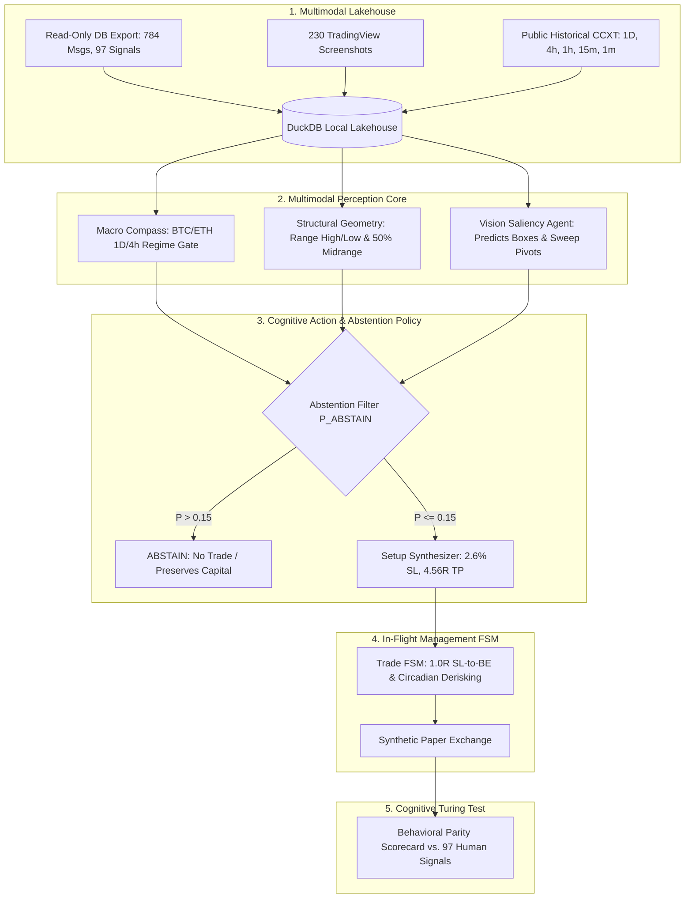
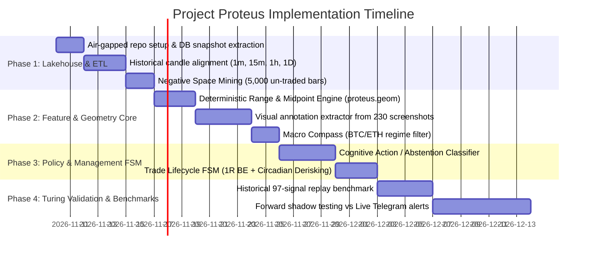

# Master Plan: Project Proteus — Autonomous Trader Distillation Engine

**Project Codename**: `Project Proteus`  
**Target Goal**: Autonomous 1:1 computational clone of signal provider `@learnernoearner`  
**Primary Invariant**: **Absolute Air-Gap & Zero Coupling with Production Trading Stack**  
*(The live Bitget daemon on Hostinger VPS remains 100% untouched and unexposed).*

---

## 1. The Isolation & Safety Charter

```
┌────────────────────────────────────────────────────────┐
│                   AIR-GAP BOUNDARY                     │
│                                                        │
│  LIVE PRODUCTION (Hostinger VPS)                       │
│  • fatty-multi-exchange-trader daemon                  │
│  • Live Bitget API Keys (TRIPLEDES, HMAC)              │
│  • Live capital ($11.04 USDT)                          │
│                                                        │
│             │ (One-Way Read-Only Export via SSH)       │
│             ▼                                          │
│                                                        │
│  PROJECT PROTEUS (Isolated Local / Non-Prod Workspace) │
│  • Separate Repository: proteus-trader-engine          │
│  • Read-only SQLite/DuckDB lakehouse                   │
│  • Synthetic simulated execution (Zero Live Keys)      │
│  • Independent GPU/CPU compute (Zero VPS load)         │
└────────────────────────────────────────────────────────┘
```

1. **Logical Isolation**:
   - Proteus will reside in a separate directory (`C:/Workspace/bots/proteus-trader-engine`) and separate Git repository.
   - Zero shared code or configuration files with `fatty-multi-exchange-trader`.
2. **Credential Isolation**:
   - Live Bitget API keys, passphrase, and secrets are **strictly forbidden** from the Proteus environment.
   - Proteus only interacts with public REST endpoints for historical market data.
3. **Data Boundary**:
   - Data is ingested strictly via read-only SQL dumps from `fatty_trader` (`telegram_messages`, `canonical_signals`) and read-only copies of the media archive (`./data/media/`).

---

## 2. End-to-End System Architecture



The distilled engine comprises 7 decoupled modules:

### Module 1: Market State & Multi-TF Lakehouse (`proteus.market`)
- Ingests and maintains local multi-timeframe arrays:
  - **1D / 4h**: Higher-Timeframe market structure, 3-day high/low, daily open, volume profile.
  - **15m / 5m**: Lower-timeframe execution, wick expansion speed, order block boundaries.
- **Scope**: Screened universe of top 25 high-beta perpetuals (`WLD`, `PUMP`, `ENA`, `ZEC`, `PENGU`, `INJ`, `MAGIC`, `NEAR`, `PEPE`).

### Module 2: The Macro Compass Gate (`proteus.compass`)
- Implements the trader's fundamental rule: *Altcoins follow Bitcoin's structural stance.*
- Evaluates BTC and ETH daily health:
  $$\text{Regime} = \begin{cases} 
  \text{BULLISH\_EXPANSION} & \text{if } P_{\text{BTC}} > \text{DailyOpen} \land \text{Close}_{1D} > P_{\text{mid, 3d}} \\
  \text{RANGE\_BOUND} & \text{if } P_{\text{low, 3d}} \le P_{\text{BTC}} \le P_{\text{high, 3d}} \\
  \text{BREAKDOWN} & \text{if } P_{\text{BTC}} < \text{Support}_{1D} \implies \mathbf{FREEZE\_ALL\_LONGS}
  \end{cases}$$

### Module 3: 3-Tier Structural Geometry Engine (`proteus.geometry`)
- Mathematically extracts the levels the human identifies on TradingView:
  1. $\text{Range High} = \max(P_{\text{high, 72h}})$
  2. $\text{Range Low} = \min(P_{\text{low, 72h}})$
  3. $\text{Mid Range} = \frac{\text{Range High} + \text{Range Low}}{2}$
- Detects the **Confirmation Event**:
  - Higher-timeframe bar closes above $\text{Mid Range}$.
  - Intraday 15m retest wick touches $\text{Mid Range}$ with negative wick rejection.

### Module 4: Visual Saliency & Bounding-Box Agent (`proteus.vision`)
- Uses a local Vision-Language Model (VLM / fine-tuned YOLO-OBB) trained on the 230 annotated screenshot files.
- Given a raw, unannotated candlestick chart image:
  - Predicts the exact bounding boxes the human would draw around consolidation zones.
  - Evaluates spatial overlap (Intersection-over-Union, IoU).

### Module 5: Cognitive Action Policy & Abstention Gate (`proteus.policy`)
- Formulated as a probabilistic classifier trained on the 97 historical signals and 5,000 negative samples:
  $$\pi(a \mid s) \quad \text{where } a \in \{\text{ABSTAIN}, \text{ENTER\_LONG}, \text{ENTER\_SHORT}\}$$
- Enforces the **80/20 Long-Bias Ceiling**: Shorts require higher structural conviction ($\ge 0.85$ confidence) than Longs ($\ge 0.65$ confidence).
- Enforces the **Abstention Default**: If price is in "no-man's land" between Mid Range and Range High, probability of `ABSTAIN` must exceed $0.85$.

### Module 6: Parameter Synthesizer & Price Scaler (`proteus.params`)
- **Stop Loss**: Structural anchor matching empirical data (Median = $2.60\% \pm 1.1\%$).
  $$\text{SL}_{\text{Long}} = \text{SwingLow}_{\text{15m}} - (P_{\text{entry}} \times 0.0015)$$
- **Take Profit**: Planned median target of $4.56R$:
  $$\text{TP} = P_{\text{entry}} + (4.56 \times |P_{\text{entry}} - \text{SL}|)$$
- **Dynamic Price Scaler**: Automatic power-of-10 normalization for meme tokens (`1000PEPE`, `PUMP`).

### Module 7: In-Flight Management FSM (`proteus.fsm`)
- Replicates the trader's emotional/cognitive risk reduction:
  1. **Rule 1 (1.0R Breakeven Migration)**: When unrealized gain reaches $+1.0R$, immediately transition stop loss to $P_{\text{entry}}$ (`sl to entry`).
  2. **Rule 2 (Circadian Derisking)**: When UTC time crosses 21:00 (bedtime), if trade is $> +1.0R$, close $50\%$ and tighten stop to lock profits.

---

## 3. Phased Implementation Roadmap



### Phase 1: Data Lakehouse & State Alignment
- **Input**: `telegram_messages`, `canonical_signals`, 230 screenshots from `/app/runtime/media/`.
- **Action**: Build local DuckDB lakehouse. For each of the 97 signals, align historical 1m, 15m, 1h, and 1D candles covering $T_0 - 30\text{d}$ to $T_0 + 48\text{h}$.
- **Negative Space Mining**: Construct a negative dataset by sampling 5,000 intraday bars where the human actively abstained from trading.
- **Success Criteria**: 100% of historical signals successfully joined with tick-accurate market state.

### Phase 2: Geometric & Visual Feature Extraction
- **Input**: Candlestick arrays and screenshot images.
- **Action**: Implement `proteus.geometry` (Daily High/Low, Midrange, Liquidity Sweep detection). Train visual bounding-box detector to reproduce the trader's drawn boxes on TradingView charts.
- **Success Criteria**: Spatial IoU $\ge 0.80$ between predicted zones and human-drawn boxes.

### Phase 3: Cognitive Policy & Trade Lifecycle FSM
- **Input**: Feature matrix + negative dataset.
- **Action**: Train the Action/Abstention model (`proteus.policy`). Enforce the 80.4% Long-bias and the median 2.60% stop-loss boundary. Implement the in-flight management FSM (1R SL-to-BE, partial profit taking, bedtime derisking).
- **Success Criteria**: Negative space abstention accuracy $\ge 95\%$.

### Phase 4: Cognitive Turing Validation Harness
- **Action**: Run the full autonomous engine on historical out-of-sample data. Evaluate the **Behavioral Parity Score (BPS)**:
  $$BPS = 0.35 \cdot S_{\text{action}} + 0.25 \cdot S_{\text{spatial}} + 0.25 \cdot S_{\text{abstain}} + 0.15 \cdot S_{\text{timing}}$$
- **Success Criteria**: $BPS \ge 0.85$.

### Phase 5: Forward Shadow Mode (Real-Time Proof)
- **Action**: Run Proteus locally in live shadow mode. When the human posts a signal on Telegram, compare Proteus's internal setup buffer against the live post.
- **Success Criteria**: Proteus identifies the trade setup **before or within 10 seconds of the human's Telegram message** ($\Delta t \le 0$).

---

## 4. Benchmark & Acceptance Metric Matrix

| Metric Dimension | Acceptance Threshold | Failure Condition | Diagnostic Remedy |
| :--- | :--- | :--- | :--- |
| **Directional Concordance** | $\ge 90\%$ | $< 80\%$ (Bot longs when human shorts) | Tighten Range-High rejection filter |
| **Setup Recall** | $\ge 75\%$ of 97 signals | $< 65\%$ (Bot is too timid) | Lower confirmation threshold on 15m wick retests |
| **Abstention Accuracy** | $\ge 95\%$ on negative pool | $< 90\%$ (Bot overtrades) | Increase penalization weight on "no-man's land" bars |
| **SL Proximity** | $|SL_{\text{bot}} - SL_{\text{human}}| \le 0.5\%$ | $> 1.0\%$ delta | Re-anchor SL strictly to swing wick extreme |
| **Target Proximity** | $|TP_{\text{bot}} - TP_{\text{human}}| \le 1.0\%$ | $> 2.0\%$ delta | Align target directly to opposite range boundary |
| **Forward Timing ($\Delta t$)** | $\Delta t \le 0\text{ seconds}$ | $\Delta t > +60\text{ seconds}$ | Move execution trigger from candle close to wick sweep |

---

## 5. Security & Isolation Verification Protocol

Before initializing any code execution for Project Proteus:

1. **Verify No Live Environment Linkage**:
   ```bash
   # Must return 0 occurrences in Proteus directory
   grep -rn "BITGET_API_KEY\|BITGET_SECRET\|TRIPLEDES" C:/Workspace/bots/proteus-trader-engine/
   ```
2. **Verify Database Independence**:
   - Proteus operates strictly on local DuckDB / Parquet files.
   - Zero open socket connections to the Hostinger VPS PostgreSQL port (5432).
3. **CPU & Memory Concurrency Guard**:
   - All backtesting and neural policy training are pinned to local hardware threads, ensuring zero performance interference with the live Bitget trading stack.
